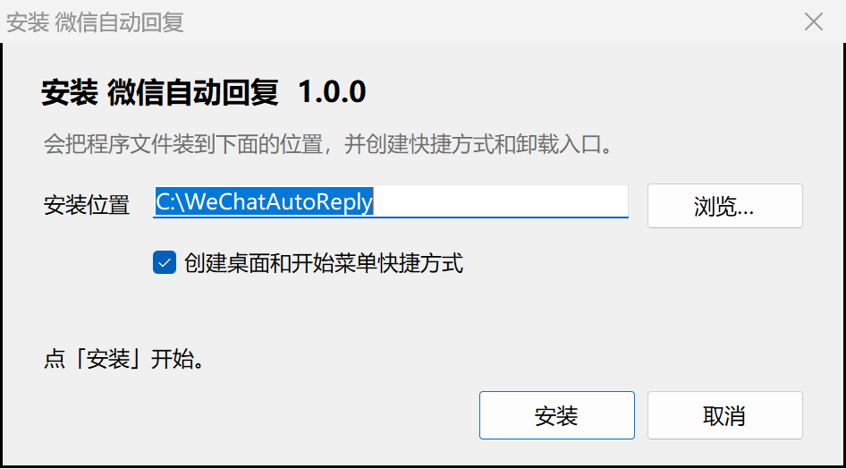
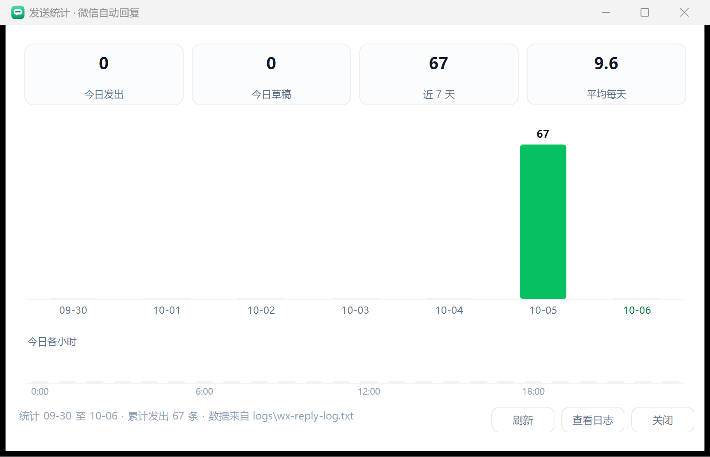

# 微信自动回复控制台

Windows 上的一个「微信自动回复」小程序：从当前微信会话读屏拿到最新消息，交给本机的大模型生成回复，再通过界面自动化把回复发出去。带独立控制面板、发送统计、日志查看器、深浅主题、多联系人管理和安装包。

> ⚠️ **免责声明**：本项目仅供个人学习与研究。程序是通过操作微信界面来实现读消息和发消息的，属于自动化操作，微信的服务协议并不欢迎这类行为，请自行评估风险（包括账号被限制的可能）。使用造成的任何后果由使用者自己承担。请勿用于骚扰他人或商业营销。

## 功能

| 功能 | 说明 |
| --- | --- |
| 控制面板 | 一键起停、状态、今日发出、待发队列、最后动作、最后发出 |
| 只造草稿 | dryrun 模式，只让模型生成、不真发，先看会怎么回 |
| 发送统计 | 近 7 天柱状图 + 今日各小时分布 |
| 日志查看器 | 面板里直接翻 `watch.log` / 回复日志，支持筛选与自动刷新 |
| 主题 | 浅色 / 深色，记住上次选择 |
| 多联系人 | 每个联系人一套提示词，随时切换当前回复对象 |
| 托盘 | 气泡提醒（已发送 / 被拦 / 发送失败）、右键菜单快捷操作 |
| 安装包 | 注册表卸载项、可覆盖升级、标准卸载 |




## 它是怎么工作的

```
微信窗口 ──读屏──> 最新一条消息
                    │
                    ├─ 是对方发的？ ──> 拼提示词 ──> 本机模型运行时 ──> 回复文本
                    │
                    └─ 通过界面自动化：激活窗口 → 定位输入框 → 粘贴 → 点发送
                                          │
                                          └─ 失败则入队，按 20s→40s→…→5min 退避重试
```

读屏优先用 UI Automation；拿不到时退化为 OCR / 静默截图（窗口被遮挡或最小化也能读）。发送前会校验当前会话标题，标题对不上就拒绝发送。

## 安装

1. 下载 `微信自动回复-安装.exe`，双击（会自动请求管理员权限，以便写入安装目录）。
2. 装完桌面和开始菜单会出现「微信自动回复」。
3. 打开面板 → 在「联系人」里添加一个联系人（**名字必须和微信会话标题完全一致**）→ 粘贴你自己的提示词 → 点「启动」。

只想先看看效果：把面板上的「只造草稿，不真的发送」拨开，状态会变成 `dryrun`，不会真发。

## 提示词

程序**不内置任何提示词**，必须自己写。`prompt-examples/` 里给了两份模板，说明了可用的占位符：

| 占位符 | 含义 |
| --- | --- |
| `{{CONTACT}}` | 当前联系人名字 |
| `{{TRANSCRIPT}}` | 刚从聊天窗口读出来的对话记录（`[我]` / `[对方]`） |
| `{{NOW}}` | 当前时间 |
| `{{RECENT}}` | 我最近已经发过的消息（用于避免重复） |

用法：把模板复制成程序目录下的 `reply-prompt-text.txt`（收消息时用）和 `proactive-prompt-text.txt`（长时间没动静时主动搭话用），再往里写你自己的规则。面板的「联系人」里也能直接编辑每个人的提示词。

## 依赖

- Windows 10 / 11，微信桌面版保持登录
- PowerShell 5.1（系统自带）
- 生成回复需要一个本机的命令行模型运行时。当前代码默认调用 DeepSeek Harness（`node.exe` + `dsh`），路径在 `wx-watch.ps1` 顶部的 `$script:NodeExe` / `$script:DshBin`；换成别的命令行模型工具也可以，改这两行即可。路径不存在时面板照常起停，只是生成会失败并记进 `watch.log`。

## 目录结构

| 文件 | 作用 |
| --- | --- |
| `wx-panel.ps1` / `wx-panel.exe` | 控制面板（界面 + 起停 + 日志查看 + 统计 + 联系人） |
| `wx-watch.ps1` | 主循环：读屏 → 生成 → 发送 → 记录 |
| `wx-watch-daemon.ps1` | 后台守护进程（配合开机自启） |
| `wx-core.ps1` | 联系人、提示词、待重发队列、公共配置 |
| `wx-uia.ps1` | UI Automation 读屏 |
| `wx-ocr-lib.ps1` / `wx-capture.ps1` / `wx-shot-lib.ps1` | OCR 与静默截图回退 |
| `wx-send.ps1` / `wx-record.ps1` | 发送与结果记录 |
| `winio.ps1` / `winenum.ps1` | Win32 窗口助手（枚举、前台、点击、输入） |
| `app-tools.ps1` | 快捷方式与开机自启的增删 |
| `installer.cs` / `build-installer.ps1` | 安装包源码与构建脚本 |
| `prompt-examples/` | 提示词模板（只有占位符说明，没有具体规则） |

运行时数据都在程序目录下，且**不会**被安装包覆盖：`state/`（模式、联系人、待发队列）、`logs/`（每轮判断过程与发出的消息）、`shots/`（截图）。

## 自己构建

```powershell
# 面板 exe（图标 + 清单）
powershell -NoProfile -ExecutionPolicy Bypass -File build-icon.ps1 -Style bubble

# 安装包（把程序文件打成 payload.zip 内嵌进 exe）
powershell -NoProfile -ExecutionPolicy Bypass -File build-installer.ps1 -App <程序目录> -Work <程序目录>
```

## 已知限制

- 只处理面板上选中的那一个会话；换会话需要重新设置，不会自动切换。
- 发送有 20 秒最小间隔；被间隔拦住或发送失败会入队，按 20s → 40s → 80s → … → 5min 退避重试，超过次数上限会放弃并在日志里记 `GIVEUP`。
- 微信必须在登录状态；窗口被最小化时走静默截图，识别率会下降。
- 没有内置提示词，开箱不能直接用，必须先写自己的规则。

## License

未指定许可证（保留所有权利）。要开源请自行添加 LICENSE 文件。